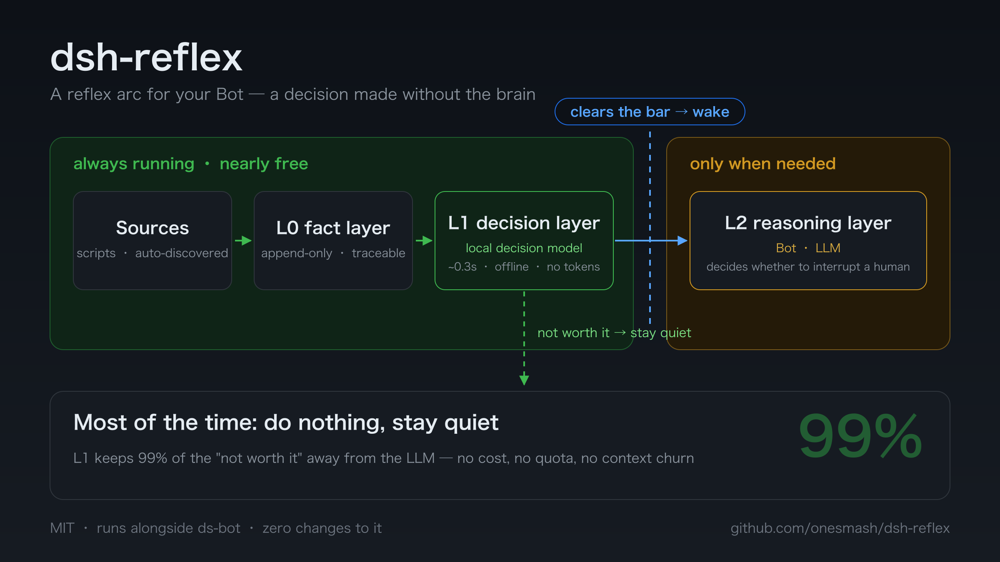
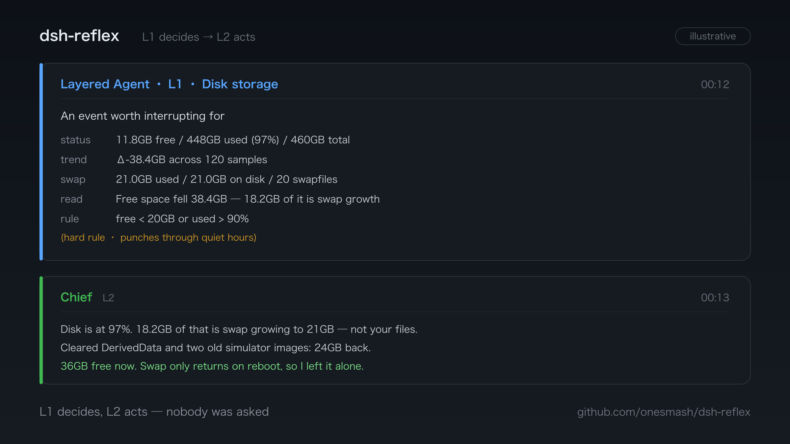

# dsh-reflex

> A **reflex arc** for [ds-bot](https://github.com/Fei2411/DeepSeek-Bot): stay quiet most of the time, and wake the LLM only when it is worth its attention.

A sibling plugin for DSH (DeepSeek Harness). It runs alongside ds-bot and **modifies none of it**.

[中文](README.md) | English

---

## The problem it solves

LLMs are a bad fit for polling. Waking one every five minutes to ask "anything new?" wastes money and quota on a question whose answer is almost always "no" — and each round still has to chew through its context.

dsh-reflex **moves the judgement down to where it is cheap**. The cheap layers run continuously (collecting facts, scoring them with a local decision model); the expensive layer is woken only when something crosses a threshold. Hence "reflex": a decision made without the brain.



<details>
<summary>Plain-text version (same diagram, terminal-friendly)</summary>

```
               ┌─── always running, nearly free ───┐   ┌─ only when needed ─┐
  sources  ──►   L0 fact layer  ──►  L1 decision layer  ──►  L2 reasoning layer
  (scripts)      (append-only store)  (local decision model)   (ds-bot / LLM)
                                            │
                                            └─ most of the time: do nothing, stay quiet
```

</details>

## What each layer does

| Layer | Responsibility | Cost | How |
|---|---|---|---|
| **L0** | Collect facts into a traceable timeline | Very low | Script-driven; auto-discovers `collectors/*.sh` |
| **L1** | Decide whether something deserves L2's attention | Very low (local decision model, one forward pass) | Script-driven; auto-discovers `targets/*.sh` |
| **L2** | Decide whether to interrupt a human, and how | High | Wakes a Bot inside ds-bot |

**Why the split**: deciding whether to interrupt a human is genuinely an LLM's job — it just shouldn't happen after every single collection cycle. L1 filters first with a local decision model ([SemIf](https://github.com/TheoLeeCJ/SemIf) reads answer-slot logits, ~0.3 s, no network) and keeps 99% of the "not worth it" away from L2.

## What a wake-up looks like

When L1 fires, what reaches L2 is a structured notice (field names come from a real built-in target's renderer). Whether to interrupt a human — and how — is L2's call:



## Relationship to ds-bot

- An independent cordis plugin, mounted via `insert` in `cordis.patch.yml`
- Runs **in the same process** as ds-bot (it needs `sessionController` to deliver a wake-up) but **changes nothing** in the original
- A failed init degrades to a log line and **never takes the host down** — a hard requirement for a sibling plugin

## Install

```bash
dsh plugin --profile <your-profile> add github:onesmash/dsh-reflex
```

`dsh plugin` forwards its arguments to pnpm inside the profile directory. It fetches and installs the package and — because this package declares `dsh.bundle` in its `package.json` — also appends `dsh-reflex` to that profile's `dsh.profile.bundles`. Dependencies are installed into the profile along with the package; nothing else is required.

Verify the layer without starting anything:

```bash
dsh --profile <your-profile> --dump-config    # should show "# == dsh-reflex"
```

Then give the plugin a config block in the same profile's `cordis.patch.yml`:

```yaml
- id: dsh-reflex
  config:
    l0:
      sources: [disk, swap]        # which collectors are enabled
    l1:
      targets: [disk]              # which decision targets are enabled
      targetBot: Chief             # which Bot to wake
      quietHours: { from: '18:00', to: '09:00' }
```

Restart DSH to take effect (script sources/targets need none of this: any `.sh` dropped into `collectors/` or `targets/` is auto-enabled via hot discovery — add the file and it works within the next round, `<name>.paused` or deleting the file removes it). The log will show:

```
dsh-reflex installed: L0=60000ms L1=60000ms target="Chief" sources=[disk,swap] targets=[disk,x-timeline]
```

### Local development: point at your checkout

When you are changing the plugin itself, install by **path** — pnpm creates a symlink, so your edits follow the source directly:

```bash
dsh plugin --profile <your-profile> add /absolute/path/to/dsh-reflex
```

**In this mode, dependencies must be installed inside the checkout**: a linked install keeps its own `node_modules`, and Node resolves dependencies through the repository's real path, so run this once:

```bash
cd /absolute/path/to/dsh-reflex && pnpm install
```

(Installing from GitHub does not have this issue — package and dependencies go into the profile together.)

## Configuration

Every option can be overridden under `dsh-reflex.config` in the profile patch. The important ones:

| Option | Default | Meaning |
|---|---|---|
| `l0.intervalMs` | 60000 | Collection interval |
| `l0.sources` | `[disk]` | Enabled sources; `disk`/`swap` are built in, others come from `collectors/*.sh` |
| `l0.homeDir` | `~/.dsh/dsh-reflex` | Working directory (override with the `REFLEX_HOME` env var) |
| `l1.intervalMs` | 60000 | Decision interval |
| `l1.targets` | `[disk]` | Enabled **built-in** decision targets; script targets need no entry here (drop-in via file presence) |
| `l1.threshold` | 0.8 | Local-model score threshold |
| `l1.hardRule` | `{lowAvailableGB:20, highUsedPct:90}` | Hard rules (e.g. disk alarms); these pierce quiet hours |
| `l1.targetBot` | `Chief` | Which Bot gets woken on an L1 hit |
| `l1.cooldownMs` | 1800000 | Cooldown for the same state, to avoid repeat wake-ups |
| `l1.quietHours` | `null` | Content-type hits are held instead of delivered, then merged into one digest afterwards |
| `l1.profile` | `''` | User profile, used to build the decision context |

The **decision backend** is switchable (the `backend` field): local SemIf (default, no network) or hosted Jev. The adapter layer lives in `tools/semif-adapt.py`.

## Data sources: you write them

**This repository contains no `collectors/`, `targets/` or `tools/`.** Those are yours — which sources to watch, what the criteria are, which channel an acknowledgement goes out on. They differ per person and per environment, so they are not part of the framework. They live only in the runtime directory (default `~/.dsh/dsh-reflex/`).

On startup the plugin scans:

```
~/.dsh/dsh-reflex/
├── collectors/     <name>.sh → auto-registered as a source (pair with <name>.env.json for parameters)
├── targets/        <name>.sh → auto-registered as a decision target
├── tools/          helpers your scripts can call
├── facts/          raw L0 facts, split per source and per day
└── dsh-reflex.log
```

**The full contract, templates and a verification checklist are in [DATASOURCE.md](DATASOURCE.md)** — also shipped as an auto-loadable skill under `skill/reflex-datasource/`.

## Layout

```
index.js              host side: L0 scheduling + L1 decisions + wake-up delivery
client.js             panel side: the config form
cordis.patch.yml      mount declaration
DATASOURCE.md         data-source development contract
skill/                capability packs distributed with the plugin
tests/                regression tests
```

## Third party

Two pieces of third-party content ship with the plugin under `skill/`, each keeping its own licence and attribution:

| Package | Source | Licence |
|---|---|---|
| `skill/semif-decide/` | [SemIf](https://github.com/TheoLeeCJ/SemIf) source snapshot | MIT |
| `skill/typesafe-ai/` | TypeSafe official agent skill | MIT |

Both use a **seed-only** policy: they are installed only when *absent* locally, and skipped otherwise — so an upstream version you installed yourself is never silently downgraded.

## License

[MIT](LICENSE)


## Tuning the decision layer (reflex-tuning)

Thresholds and rubric wording should not be guessed. The plugin ships a `reflex-tuning` skill
(auto-deployed to `~/.agents/skills/reflex-tuning/`) that provides a replayable loop:
shadow scoring → facts replay → stratified labeling → threshold fitting / rubric A-B /
risk certificate / calibration → wake policy (single-item hold & merge) and policy simulation.
Targets reference the scripts via `REFLEX_TUNING_DIR`; the runtime directory keeps no copy.
Contract: `skill/reflex-tuning/SKILL.md`; experiment log: `docs/threshold-fitting.md`.
